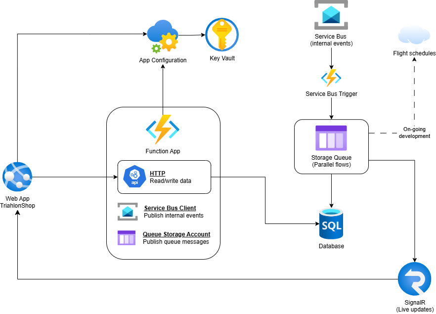

# app.triathlonshop

## Purpose
This project is a portfolio demonstration of building cloud-native applications with .NET and Azure. It showcases

- API development
- SQL data persistence
- Infrastructure as code using Bicep
- App configuration and Key Vault for secrets management and app settings
- Event-driven workflows using Service Bus
- Parallel background workflows using Storage Queues
- Separation of backend and frontend
- Real-time updates with SignalR
- GitHub Actions CI/CD pipelines that build and deploy the web app and function app in Azure

## Cloud architecture

## Live demo
**Note**: The first request after a period of inactivity is slow because the database tier pauses while idle to reduce costs. Solution: Be patient and reload after approximately 30 seconds.

https://app-triathlonshop-dev-peach-endtdzegb4apced0.swedencentral-01.azurewebsites.net/orders
